<div align="center">

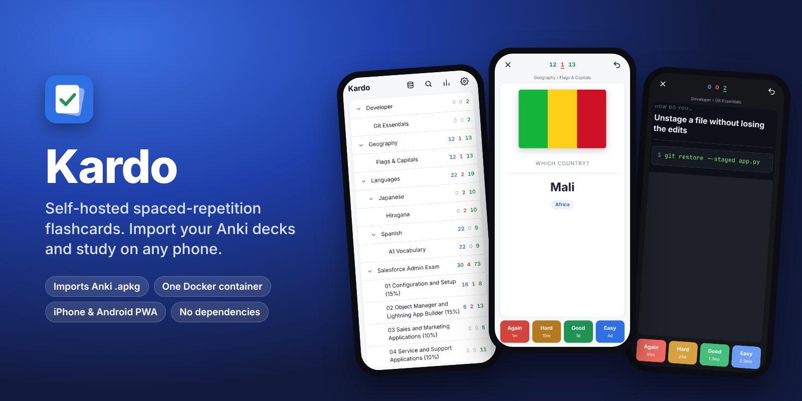

# Kardo

**Your own flashcard server. Bring your Anki decks, study them on any phone.**

Kardo is a self-hosted spaced-repetition app that imports Anki `.apkg` decks and CSV files,<br>
runs as one small Docker container, and installs on your phone's Home Screen like a native app.

[](https://github.com/Echosky/kardo/actions/workflows/ci.yml)
[](https://github.com/Echosky/kardo/pkgs/container/kardo)
[](LICENSE)


[Quick start](#quick-start) · [Screenshots](#screenshots) · [Features](#features) · [Install](#installation) · [Phone setup](#put-it-on-your-phone) · [Docs](docs/) · [FAQ](#faq)

</div>

---

## Why Kardo

You have decks you care about, a home server, and a phone. You want to review on the
phone without a subscription, an app-store purchase per platform, or your study history
living on someone else's computer.

Kardo is the smallest thing that does that well:

- **One container, one folder.** Every deck and review lives in a single SQLite file, with images and audio beside it. Back up by copying one folder.
- **No dependencies.** The server is ~1,100 lines of standard-library Python. The web app is plain JavaScript with no build step. Nothing to `npm install`, no framework to keep patched.
- **Your Anki decks, as they look in Anki.** Note-type CSS, images, audio, cloze deletions, subdecks and tags come across, and each card renders in its own sandbox so a deck's styling can't break the app.
- **Feels like an app.** Add it to the Home Screen on iPhone or Android and it opens full-screen, with light and dark mode and big thumb-friendly answer buttons.
- **Private by default.** It is designed to sit inside your home network or tailnet. No accounts, telemetry or outbound calls.

## Screenshots

Every screen below is a real capture of Kardo at iPhone size, running the decks in [`samples/`](samples/)
plus a 394-card certification-prep deck. Scroll sideways to see them all.

<table>
<tr>
<td align="center" valign="top">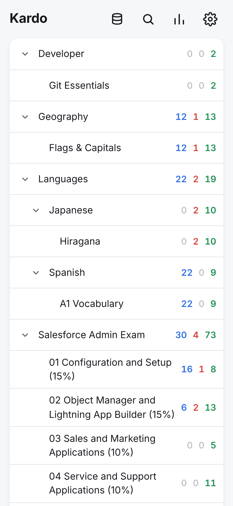<br><b>Deck tree</b><br>New · learning · due at a glance<br>&nbsp;&nbsp;&nbsp;&nbsp;&nbsp;&nbsp;&nbsp;&nbsp;&nbsp;&nbsp;&nbsp;&nbsp;&nbsp;&nbsp;&nbsp;&nbsp;&nbsp;&nbsp;&nbsp;&nbsp;&nbsp;&nbsp;&nbsp;&nbsp;&nbsp;&nbsp;&nbsp;&nbsp;&nbsp;&nbsp;&nbsp;&nbsp;&nbsp;&nbsp;&nbsp;&nbsp;&nbsp;&nbsp;&nbsp;&nbsp;&nbsp;&nbsp;&nbsp;&nbsp;&nbsp;&nbsp;&nbsp;&nbsp;&nbsp;&nbsp;&nbsp;&nbsp;</td>
<td align="center" valign="top">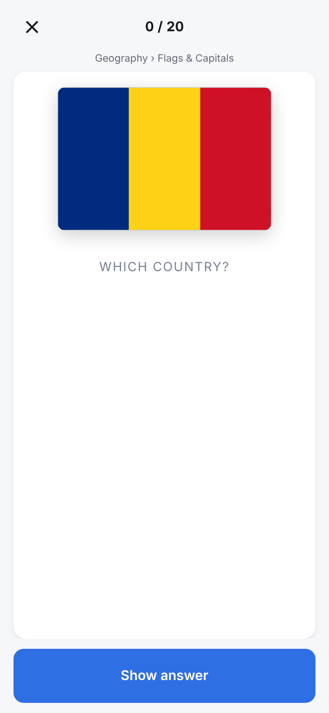<br><b>Image cards</b><br>Media from the .apkg<br>&nbsp;&nbsp;&nbsp;&nbsp;&nbsp;&nbsp;&nbsp;&nbsp;&nbsp;&nbsp;&nbsp;&nbsp;&nbsp;&nbsp;&nbsp;&nbsp;&nbsp;&nbsp;&nbsp;&nbsp;&nbsp;&nbsp;&nbsp;&nbsp;&nbsp;&nbsp;&nbsp;&nbsp;&nbsp;&nbsp;&nbsp;&nbsp;&nbsp;&nbsp;&nbsp;&nbsp;&nbsp;&nbsp;&nbsp;&nbsp;&nbsp;&nbsp;&nbsp;&nbsp;&nbsp;&nbsp;&nbsp;&nbsp;&nbsp;&nbsp;&nbsp;&nbsp;</td>
<td align="center" valign="top">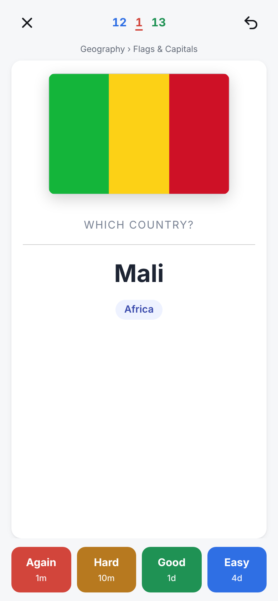<br><b>Four-button grading</b><br>Each shows its next interval<br>&nbsp;&nbsp;&nbsp;&nbsp;&nbsp;&nbsp;&nbsp;&nbsp;&nbsp;&nbsp;&nbsp;&nbsp;&nbsp;&nbsp;&nbsp;&nbsp;&nbsp;&nbsp;&nbsp;&nbsp;&nbsp;&nbsp;&nbsp;&nbsp;&nbsp;&nbsp;&nbsp;&nbsp;&nbsp;&nbsp;&nbsp;&nbsp;&nbsp;&nbsp;&nbsp;&nbsp;&nbsp;&nbsp;&nbsp;&nbsp;&nbsp;&nbsp;&nbsp;&nbsp;&nbsp;&nbsp;&nbsp;&nbsp;&nbsp;&nbsp;&nbsp;&nbsp;</td>
<td align="center" valign="top">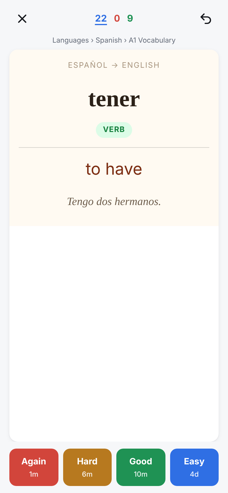<br><b>Deck styling kept</b><br>Note-type CSS, two templates<br>&nbsp;&nbsp;&nbsp;&nbsp;&nbsp;&nbsp;&nbsp;&nbsp;&nbsp;&nbsp;&nbsp;&nbsp;&nbsp;&nbsp;&nbsp;&nbsp;&nbsp;&nbsp;&nbsp;&nbsp;&nbsp;&nbsp;&nbsp;&nbsp;&nbsp;&nbsp;&nbsp;&nbsp;&nbsp;&nbsp;&nbsp;&nbsp;&nbsp;&nbsp;&nbsp;&nbsp;&nbsp;&nbsp;&nbsp;&nbsp;&nbsp;&nbsp;&nbsp;&nbsp;&nbsp;&nbsp;&nbsp;&nbsp;&nbsp;&nbsp;&nbsp;&nbsp;</td>
<td align="center" valign="top">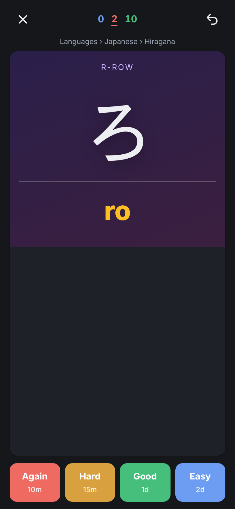<br><b>Any script, dark mode</b><br>Japanese hiragana deck<br>&nbsp;&nbsp;&nbsp;&nbsp;&nbsp;&nbsp;&nbsp;&nbsp;&nbsp;&nbsp;&nbsp;&nbsp;&nbsp;&nbsp;&nbsp;&nbsp;&nbsp;&nbsp;&nbsp;&nbsp;&nbsp;&nbsp;&nbsp;&nbsp;&nbsp;&nbsp;&nbsp;&nbsp;&nbsp;&nbsp;&nbsp;&nbsp;&nbsp;&nbsp;&nbsp;&nbsp;&nbsp;&nbsp;&nbsp;&nbsp;&nbsp;&nbsp;&nbsp;&nbsp;&nbsp;&nbsp;&nbsp;&nbsp;&nbsp;&nbsp;&nbsp;&nbsp;</td>
<td align="center" valign="top">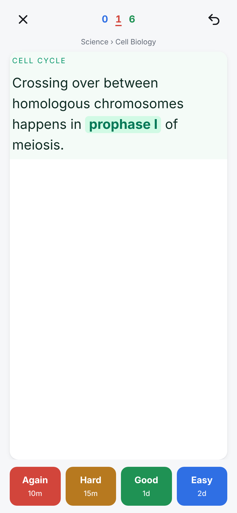<br><b>Cloze deletions</b><br>One card per gap<br>&nbsp;&nbsp;&nbsp;&nbsp;&nbsp;&nbsp;&nbsp;&nbsp;&nbsp;&nbsp;&nbsp;&nbsp;&nbsp;&nbsp;&nbsp;&nbsp;&nbsp;&nbsp;&nbsp;&nbsp;&nbsp;&nbsp;&nbsp;&nbsp;&nbsp;&nbsp;&nbsp;&nbsp;&nbsp;&nbsp;&nbsp;&nbsp;&nbsp;&nbsp;&nbsp;&nbsp;&nbsp;&nbsp;&nbsp;&nbsp;&nbsp;&nbsp;&nbsp;&nbsp;&nbsp;&nbsp;&nbsp;&nbsp;&nbsp;&nbsp;&nbsp;&nbsp;</td>
<td align="center" valign="top">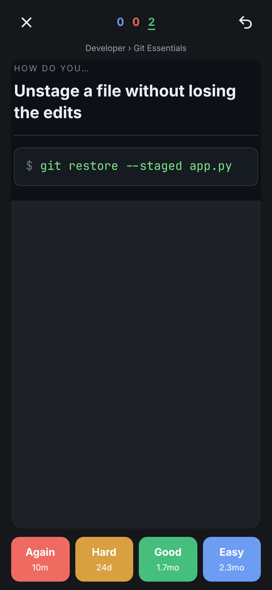<br><b>Code-friendly</b><br>Monospace, pre blocks<br>&nbsp;&nbsp;&nbsp;&nbsp;&nbsp;&nbsp;&nbsp;&nbsp;&nbsp;&nbsp;&nbsp;&nbsp;&nbsp;&nbsp;&nbsp;&nbsp;&nbsp;&nbsp;&nbsp;&nbsp;&nbsp;&nbsp;&nbsp;&nbsp;&nbsp;&nbsp;&nbsp;&nbsp;&nbsp;&nbsp;&nbsp;&nbsp;&nbsp;&nbsp;&nbsp;&nbsp;&nbsp;&nbsp;&nbsp;&nbsp;&nbsp;&nbsp;&nbsp;&nbsp;&nbsp;&nbsp;&nbsp;&nbsp;&nbsp;&nbsp;&nbsp;&nbsp;</td>
<td align="center" valign="top">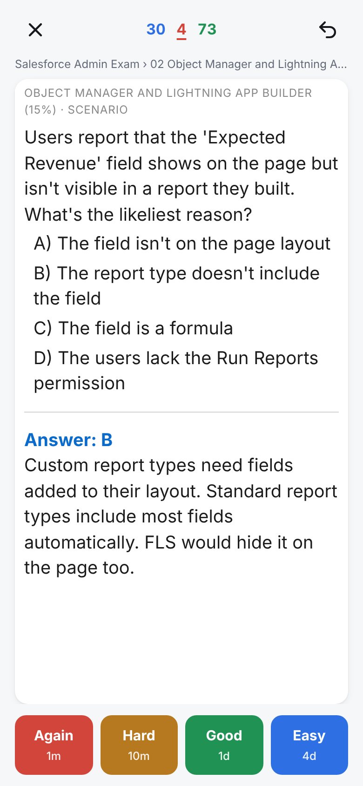<br><b>Exam prep</b><br>Long scenario questions<br>&nbsp;&nbsp;&nbsp;&nbsp;&nbsp;&nbsp;&nbsp;&nbsp;&nbsp;&nbsp;&nbsp;&nbsp;&nbsp;&nbsp;&nbsp;&nbsp;&nbsp;&nbsp;&nbsp;&nbsp;&nbsp;&nbsp;&nbsp;&nbsp;&nbsp;&nbsp;&nbsp;&nbsp;&nbsp;&nbsp;&nbsp;&nbsp;&nbsp;&nbsp;&nbsp;&nbsp;&nbsp;&nbsp;&nbsp;&nbsp;&nbsp;&nbsp;&nbsp;&nbsp;&nbsp;&nbsp;&nbsp;&nbsp;&nbsp;&nbsp;&nbsp;&nbsp;</td>
<td align="center" valign="top">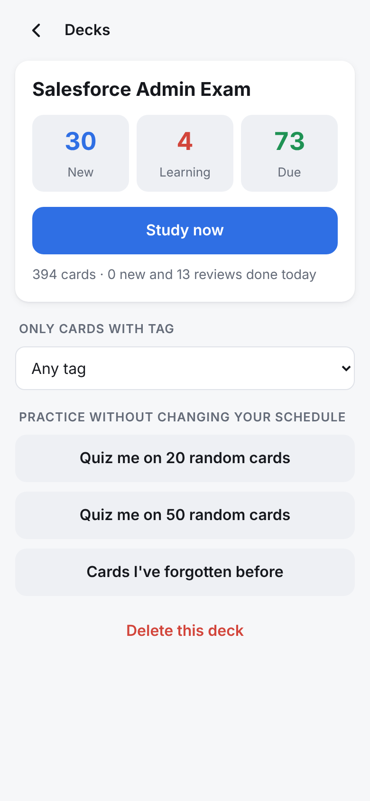<br><b>Deck overview</b><br>Tag filter and quick quizzes<br>&nbsp;&nbsp;&nbsp;&nbsp;&nbsp;&nbsp;&nbsp;&nbsp;&nbsp;&nbsp;&nbsp;&nbsp;&nbsp;&nbsp;&nbsp;&nbsp;&nbsp;&nbsp;&nbsp;&nbsp;&nbsp;&nbsp;&nbsp;&nbsp;&nbsp;&nbsp;&nbsp;&nbsp;&nbsp;&nbsp;&nbsp;&nbsp;&nbsp;&nbsp;&nbsp;&nbsp;&nbsp;&nbsp;&nbsp;&nbsp;&nbsp;&nbsp;&nbsp;&nbsp;&nbsp;&nbsp;&nbsp;&nbsp;&nbsp;&nbsp;&nbsp;&nbsp;</td>
<td align="center" valign="top">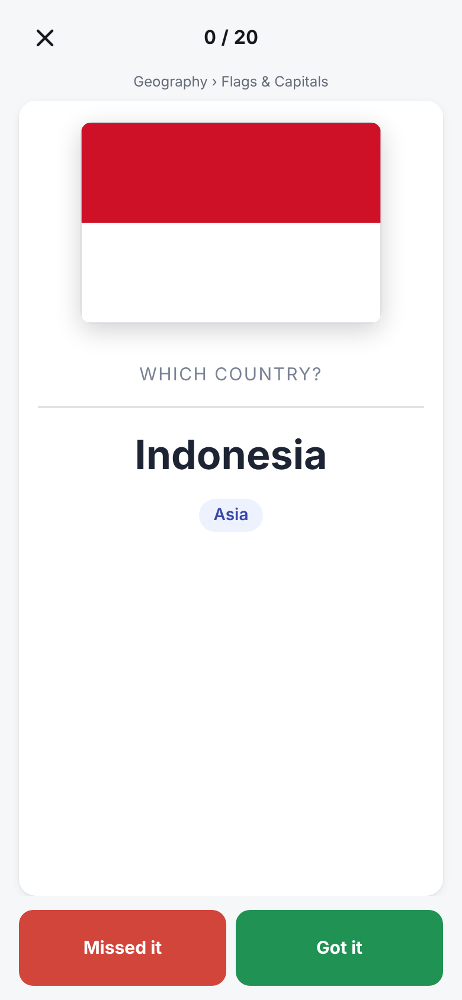<br><b>Practice mode</b><br>Quizzes that don't touch your schedule<br>&nbsp;&nbsp;&nbsp;&nbsp;&nbsp;&nbsp;&nbsp;&nbsp;&nbsp;&nbsp;&nbsp;&nbsp;&nbsp;&nbsp;&nbsp;&nbsp;&nbsp;&nbsp;&nbsp;&nbsp;&nbsp;&nbsp;&nbsp;&nbsp;&nbsp;&nbsp;&nbsp;&nbsp;&nbsp;&nbsp;&nbsp;&nbsp;&nbsp;&nbsp;&nbsp;&nbsp;&nbsp;&nbsp;&nbsp;&nbsp;&nbsp;&nbsp;&nbsp;&nbsp;&nbsp;&nbsp;&nbsp;&nbsp;&nbsp;&nbsp;&nbsp;&nbsp;</td>
<td align="center" valign="top">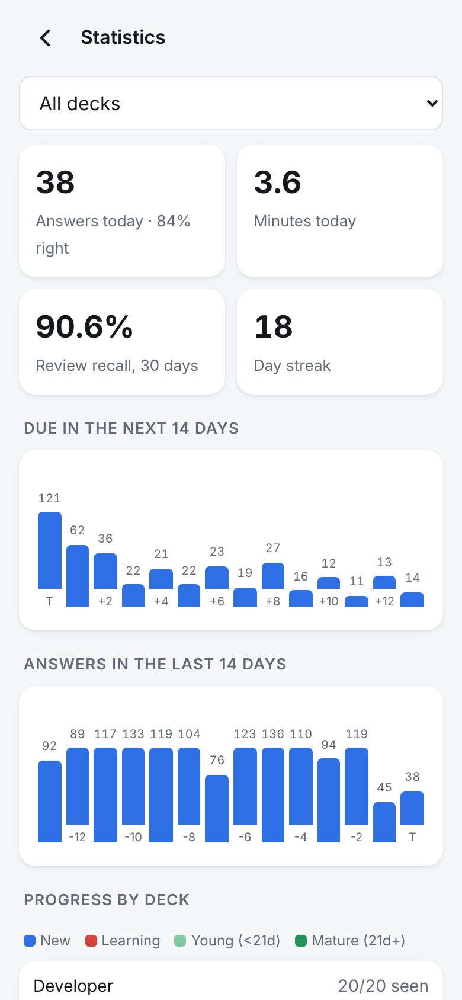<br><b>Statistics</b><br>Recall, streak, forecast<br>&nbsp;&nbsp;&nbsp;&nbsp;&nbsp;&nbsp;&nbsp;&nbsp;&nbsp;&nbsp;&nbsp;&nbsp;&nbsp;&nbsp;&nbsp;&nbsp;&nbsp;&nbsp;&nbsp;&nbsp;&nbsp;&nbsp;&nbsp;&nbsp;&nbsp;&nbsp;&nbsp;&nbsp;&nbsp;&nbsp;&nbsp;&nbsp;&nbsp;&nbsp;&nbsp;&nbsp;&nbsp;&nbsp;&nbsp;&nbsp;&nbsp;&nbsp;&nbsp;&nbsp;&nbsp;&nbsp;&nbsp;&nbsp;&nbsp;&nbsp;&nbsp;&nbsp;</td>
<td align="center" valign="top">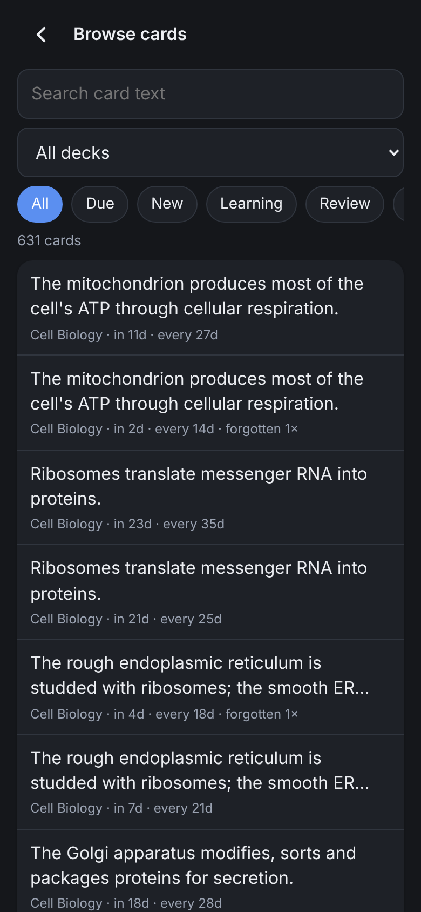<br><b>Browse &amp; search</b><br>Suspend or reset any card<br>&nbsp;&nbsp;&nbsp;&nbsp;&nbsp;&nbsp;&nbsp;&nbsp;&nbsp;&nbsp;&nbsp;&nbsp;&nbsp;&nbsp;&nbsp;&nbsp;&nbsp;&nbsp;&nbsp;&nbsp;&nbsp;&nbsp;&nbsp;&nbsp;&nbsp;&nbsp;&nbsp;&nbsp;&nbsp;&nbsp;&nbsp;&nbsp;&nbsp;&nbsp;&nbsp;&nbsp;&nbsp;&nbsp;&nbsp;&nbsp;&nbsp;&nbsp;&nbsp;&nbsp;&nbsp;&nbsp;&nbsp;&nbsp;&nbsp;&nbsp;&nbsp;&nbsp;</td>
<td align="center" valign="top">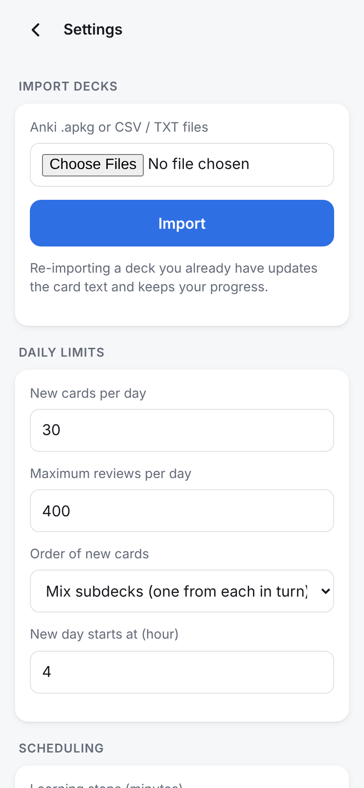<br><b>Import &amp; settings</b><br>Limits, steps, intervals<br>&nbsp;&nbsp;&nbsp;&nbsp;&nbsp;&nbsp;&nbsp;&nbsp;&nbsp;&nbsp;&nbsp;&nbsp;&nbsp;&nbsp;&nbsp;&nbsp;&nbsp;&nbsp;&nbsp;&nbsp;&nbsp;&nbsp;&nbsp;&nbsp;&nbsp;&nbsp;&nbsp;&nbsp;&nbsp;&nbsp;&nbsp;&nbsp;&nbsp;&nbsp;&nbsp;&nbsp;&nbsp;&nbsp;&nbsp;&nbsp;&nbsp;&nbsp;&nbsp;&nbsp;&nbsp;&nbsp;&nbsp;&nbsp;&nbsp;&nbsp;&nbsp;&nbsp;</td>
<td align="center" valign="top">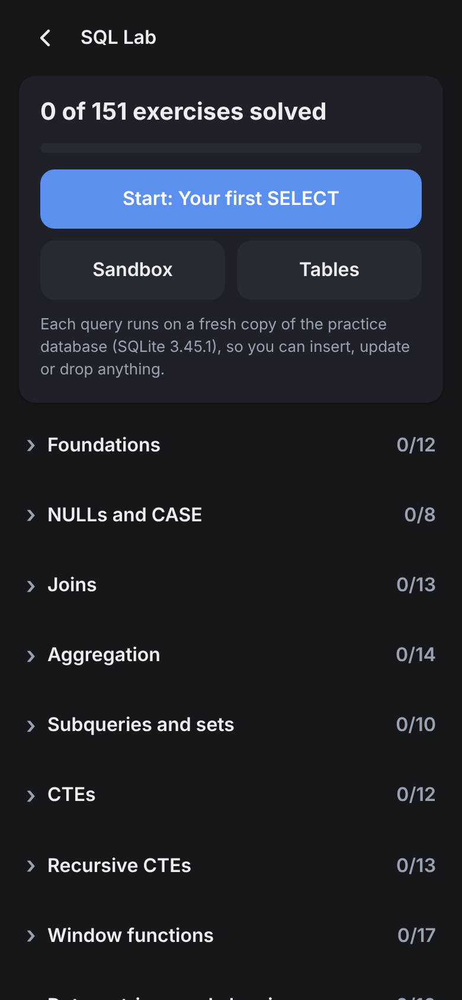<br><b>SQL Lab</b><br>151 graded SQL exercises<br>&nbsp;&nbsp;&nbsp;&nbsp;&nbsp;&nbsp;&nbsp;&nbsp;&nbsp;&nbsp;&nbsp;&nbsp;&nbsp;&nbsp;&nbsp;&nbsp;&nbsp;&nbsp;&nbsp;&nbsp;&nbsp;&nbsp;&nbsp;&nbsp;&nbsp;&nbsp;&nbsp;&nbsp;&nbsp;&nbsp;&nbsp;&nbsp;&nbsp;&nbsp;&nbsp;&nbsp;&nbsp;&nbsp;&nbsp;&nbsp;&nbsp;&nbsp;&nbsp;&nbsp;&nbsp;&nbsp;&nbsp;&nbsp;&nbsp;&nbsp;&nbsp;&nbsp;</td>
<td align="center" valign="top">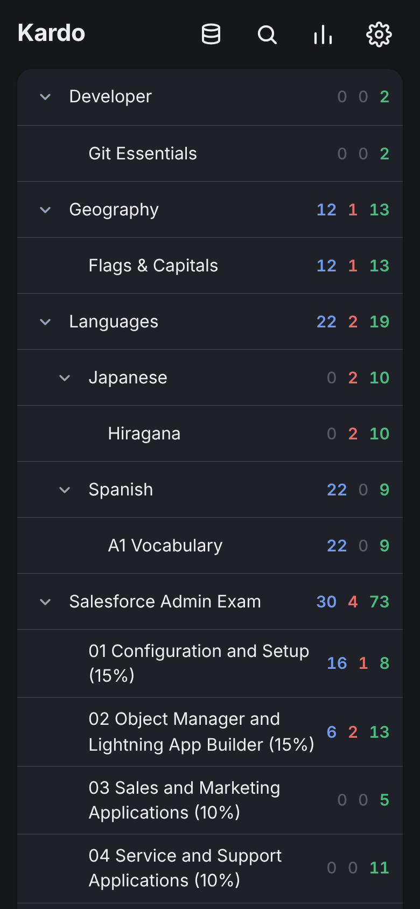<br><b>Dark mode</b><br>Follows the system or set it<br>&nbsp;&nbsp;&nbsp;&nbsp;&nbsp;&nbsp;&nbsp;&nbsp;&nbsp;&nbsp;&nbsp;&nbsp;&nbsp;&nbsp;&nbsp;&nbsp;&nbsp;&nbsp;&nbsp;&nbsp;&nbsp;&nbsp;&nbsp;&nbsp;&nbsp;&nbsp;&nbsp;&nbsp;&nbsp;&nbsp;&nbsp;&nbsp;&nbsp;&nbsp;&nbsp;&nbsp;&nbsp;&nbsp;&nbsp;&nbsp;&nbsp;&nbsp;&nbsp;&nbsp;&nbsp;&nbsp;&nbsp;&nbsp;&nbsp;&nbsp;&nbsp;&nbsp;</td>
</tr>
</table>

*The study history in these captures was generated by a script that answered cards over 30 simulated days, so the statistics screens have something to show.*

## Quick start

```sh
docker run -d --name kardo --restart unless-stopped \
  -p 8484:8484 -v kardo-data:/data \
  ghcr.io/echosky/kardo:latest
```

Open `http://<your-server>:8484`, tap the gear icon, and import an `.apkg`. To try it straight away,
download one of the [sample decks](samples/).

No Docker? Any machine with Python 3.10 or newer works:

```sh
git clone https://github.com/Echosky/kardo && cd kardo
KARDO_DATA=./data python3 server.py
```

## Features

<table>
<tr>
<td width="50%" valign="top">

### 📥 Import
- Anki **`.apkg`** packages: subdecks, multiple card templates per note, note-type **CSS**, **images**, **audio**, **cloze** deletions, tags, conditional template sections
- **CSV / TSV / TXT**, including Anki's `#separator:`, `#columns:`, `#deck:` and `#tags column:` headers
- **Re-import safely:** importing a newer version of a deck updates the card text and keeps every card's progress
- Import from the phone (Files / iCloud Drive / Google Drive) or any browser, or from the command line

</td>
<td width="50%" valign="top">

### 🧠 Spaced repetition
- SM-2 style scheduler with **Again / Hard / Good / Easy**, ease factors and interval fuzz
- Configurable **learning and relearning steps**, graduating and easy intervals, **maximum interval**
- **Daily limits** for new cards and reviews, and a configurable hour when the day rolls over
- New cards can be **interleaved across subdecks**, in order, or shuffled
- **Undo** the last answer

</td>
</tr>
<tr>
<td valign="top">

### 📱 Study anywhere
- Installable **PWA**: Add to Home Screen on iPhone and Android, full-screen, app icon
- Built for **one-handed** use, with large grade buttons and tap-to-flip
- **Keyboard shortcuts** on desktop: <kbd>Space</kbd> flips and grades Good, <kbd>1</kbd>–<kbd>4</kbd> grade, <kbd>Ctrl</kbd>+<kbd>Z</kbd> undoes
- **Light and dark** themes; decks that style `.nightMode` adapt automatically
- Progress is on the server, so phone, tablet and laptop share it

</td>
<td valign="top">

### 📊 Track and tune
- **Statistics:** answers and minutes today, 30-day recall, streak, 14-day forecast, 14-day history, maturity per deck
- **Practice quizzes** of 20 or 50 random cards, or just the ones you have forgotten before, that leave your schedule alone
- Study only cards with a given **tag**
- **Browse and search** every card, see its interval and lapses, **suspend** or **reset** it
- **One-tap backup** of the whole collection

</td>
</tr>
<tr>
<td valign="top">

### 🔒 Simple to run and trust
- ~3,000 lines in total, readable in an afternoon
- **Zero runtime dependencies**: Python standard library and SQLite
- Multi-arch image (**amd64 and arm64**): Unraid, Synology, TrueNAS, Raspberry Pi, any VPS
- Runs as an unprivileged user, has a health check, and makes no outbound connections

</td>
<td valign="top">

### 🧪 Bonus: SQL Lab
- **151 hands-on SQL exercises** in 13 tracks, from `SELECT` to window functions and recursive CTEs
- Runs against a realistic, generated online-shop database
- Every query runs in a **throwaway copy**, so `DROP TABLE` is safe to try
- Instant feedback explains *why* an answer is wrong (row count, column count, ordering)
- Ignore it if you only want flashcards; it stays out of the way

</td>
</tr>
</table>

## How it works

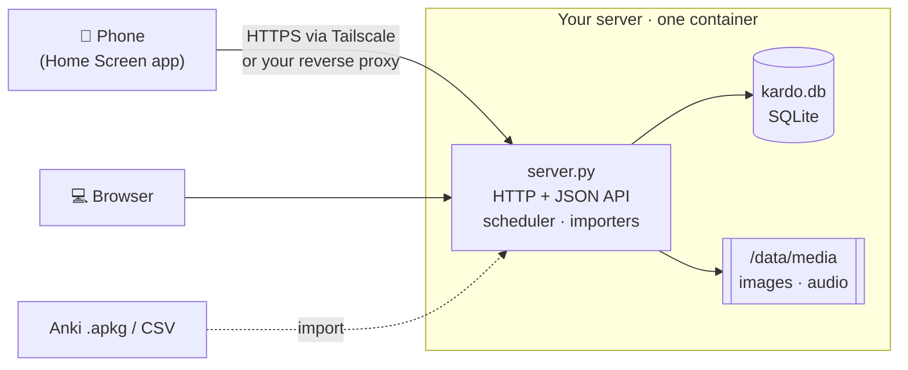

When you import a deck, Kardo renders each Anki note into finished front and back HTML using the
deck's own templates, and stores it with the note's CSS. Studying is then just a lookup: the phone asks
for the next card, shows it inside a shadow DOM with that CSS, and sends back your grade. The server
reschedules the card and writes one row to the review log. See [docs/architecture.md](docs/architecture.md).

## Installation

| Where | How |
|---|---|
| **Docker** | The [quick start](#quick-start) command above |
| **Docker Compose** | `docker compose up -d` with the included [`docker-compose.yml`](docker-compose.yml) |
| **Unraid** | Use the template in [`unraid/kardo.xml`](unraid/kardo.xml), or the step-by-step guide in [docs/installation.md](docs/installation.md#unraid) |
| **Synology / TrueNAS / Portainer** | Any Docker UI: image `ghcr.io/echosky/kardo`, port `8484`, volume `/data` |
| **Plain Python** | `python3 server.py` with `KARDO_DATA` pointing at a folder ([details](docs/installation.md#without-docker)) |

Configuration is three environment variables:

| Variable | Default | Purpose |
|---|---|---|
| `KARDO_DATA` | `/data` | Folder for `kardo.db` and `media/` |
| `PORT` | `8484` | Port to listen on. If you leave it unset and 8484 is busy, Kardo picks the next free port and says which; if you set it and it's busy, Kardo stops with a clear message |
| `KARDO_LOG` | `1` | Set to `0` to turn off the access log |

## Put it on your phone

1. **Reach the server from the phone.** The easiest secure way is [Tailscale](https://tailscale.com): install it on the server and the phone, then use the server's tailnet name, for example `http://kestrel:8484`. A reverse proxy you already run (Caddy, Nginx Proxy Manager, Traefik, Cloudflare Tunnel with Access) also works. [Remote access guide →](docs/remote-access.md)
2. **Open Kardo in the phone's browser** (Safari on iPhone, Chrome on Android).
3. **Install it.**
   - **iPhone/iPad:** tap **Share** → **Add to Home Screen**.
   - **Android:** tap **⋮** → **Install app** (or **Add to Home screen**).
4. Open Kardo from the new icon. It runs full-screen, like any other app.

> [!TIP]
> Serving Kardo over **HTTPS** (for example `tailscale serve --bg 8484`) lets the app cache itself, so it opens instantly even on a slow connection.

> [!WARNING]
> Kardo has **no login**. Keep it on your LAN, your tailnet, or behind an authenticating proxy. Do not port-forward it to the internet.

## Importing decks

In Kardo, tap ⚙️ → choose files → **Import**. Several files can be imported at once.

| Format | What comes across |
|---|---|
| `.apkg` (Anki 2.1 and the legacy format) | Decks and subdecks, every card template, note-type CSS, images, audio, cloze, tags, sort order |
| `.csv` / `.tsv` / `.txt` | Front, back, optional tags and deck columns; Anki's export header lines are honoured |
| `.colpkg` (full collection backup) | Not supported. Export the decks you want as `.apkg` instead |

From the command line: `python3 server.py import deck1.apkg deck2.csv` (or `docker exec kardo python /app/server.py import /data/deck.apkg`).

> [!NOTE]
> If a deck exported from a recent Anki version is refused, export it again with **Support older Anki versions** ticked. Kardo reads the widely supported legacy package format.

More in [docs/importing.md](docs/importing.md), including the CSV header reference.

## Scheduling in one minute

New cards step through short **learning steps** (default 1 and 10 minutes). Once they graduate, each
review multiplies the interval by the card's **ease** (starting at 250%). **Again** sends a card back to
relearning and lowers its ease; **Hard** grows the interval a little and lowers ease slightly; **Easy**
jumps further and raises ease. Small random fuzz keeps cards you learned together from always coming due together.

Studying for an exam on a fixed date? Set **Maximum interval** to about a week so nothing drifts out of rotation
before exam day. The full algorithm and every setting are in [docs/scheduling.md](docs/scheduling.md).

## Backup and restore

- **From the app:** Settings → **Download a backup of all progress** gives you a consistent copy of the database.
- **From the server:** copy the data folder. `kardo.db` holds all decks and progress; `media/` holds images and audio.
- **Restore:** stop the container, put `kardo.db` (and `media/`) back in the data folder, start it again.

Details, including automating it, in [docs/backup.md](docs/backup.md).

## How it's tested

- **Automated suite** ([`tests/`](tests/)), run by [CI](.github/workflows/ci.yml) on every push across Python 3.10 to 3.13 on Linux, and on macOS and Windows. It covers the scheduler (learning steps, lapses, ease floor, maximum interval, fuzz bounds, day rollover across time zones), template rendering (cloze, conditionals, filters, media paths), importing every sample deck with exact card and media counts, re-import keeping progress, CSV header handling, rejection of malformed packages, daily limits, undo, settings validation, HTTP end-to-end, path-traversal protection, backups, and that all 151 SQL Lab reference solutions pass their own checker.
- **Container smoke test** in CI: the image is built, started, fed a sample deck over HTTP and checked.
- **Real use:** Kardo was written for its author's own certification study: a 394-card exam deck reviewed daily on an iPhone, served from an Unraid box over Tailscale. That is the setup the defaults are tuned for.
- **Deck variety:** the [sample decks](samples/) cover images, two-template notes, custom CSS, non-Latin scripts, cloze and code blocks. They were built with [genanki](https://github.com/kerrickstaley/genanki) to make sure Kardo reads packages produced by other tools, not just by Anki itself.

Run the tests yourself with `python -m unittest discover -s tests -v`. Nothing to install.

## FAQ

<details>
<summary><b>Is this Anki? Is it affiliated with Anki?</b></summary>

No. Kardo is an independent project and is not affiliated with, endorsed by, or connected to Anki or
Ankitects Pty Ltd. It reads the `.apkg` file format so you can bring decks you already have. It contains
no Anki code. "Anki" is a trademark of its owner. If you want the full Anki ecosystem (add-ons, AnkiWeb sync,
FSRS), use Anki; it's excellent.
</details>

<details>
<summary><b>Does it sync back to Anki or AnkiWeb?</b></summary>

No. Kardo is its own study server. Import decks into it and review there. Re-importing an updated deck refreshes
card text and keeps your Kardo progress, so you can keep editing decks in Anki desktop and re-import them.
</details>

<details>
<summary><b>Does it work offline?</b></summary>

The app shell is cached, but studying needs to reach your server, because that's where your schedule lives.
With Tailscale that means "anywhere with signal".
</details>

<details>
<summary><b>Can several people use one server?</b></summary>

Kardo is built for one person: there is a single collection and no accounts. For a family, run one container
per person on different ports and data folders. They are tiny.
</details>

<details>
<summary><b>How big a collection can it handle?</b></summary>

All queries are indexed SQLite. Tens of thousands of cards are fine on a Raspberry Pi. Uploads are capped at
300 MB per file, and media-heavy decks are mostly limited by disk space.
</details>

<details>
<summary><b>Can I edit cards in Kardo?</b></summary>

Not yet: you can suspend, reset and search them. Edit in Anki desktop (or a spreadsheet for CSV decks) and re-import;
your progress is kept.
</details>

<details>
<summary><b>Does it support FSRS?</b></summary>

Not today. Kardo uses a well-understood SM-2 style scheduler. FSRS is a welcome contribution; see
[CONTRIBUTING.md](CONTRIBUTING.md).
</details>

<details>
<summary><b>Is it safe to import decks from the internet?</b></summary>

`<script>` tags in card HTML are not executed, and a deck's CSS is scoped to its card so it can't restyle the app.
Inline HTML event attributes are not stripped, though, so treat a deck like any other HTML you open: only import decks
from sources you trust. See [SECURITY.md](SECURITY.md).
</details>

## Project layout

```
server.py            HTTP server, JSON API, scheduler, importers, SQLite storage
lab.py               SQL Lab: practice database, sandboxed runner, answer checker
lab_exercises.txt    The 151 SQL exercises (plain text, easy to extend)
static/              Web app: index.html, app.js, lab.js, style.css, service worker, icons
samples/             Example .apkg decks (built by scripts/make_samples.py)
tests/               Standard-library test suite
docs/                Guides and screenshots
unraid/              Unraid Docker template
```

## Contributing

Issues and pull requests are welcome. Kardo's guiding rule is **no runtime dependencies and no build step**,
which keeps it easy to audit and to run anywhere. Read [CONTRIBUTING.md](CONTRIBUTING.md) for the dev setup
(it's one command) and what makes a change easy to merge.

## License

[MIT](LICENSE). The sample decks are original content under the same license.

<p align="center"><i>Kardo is not affiliated with Anki or Ankitects Pty Ltd. "Anki" is used only to describe file compatibility.</i></p>
