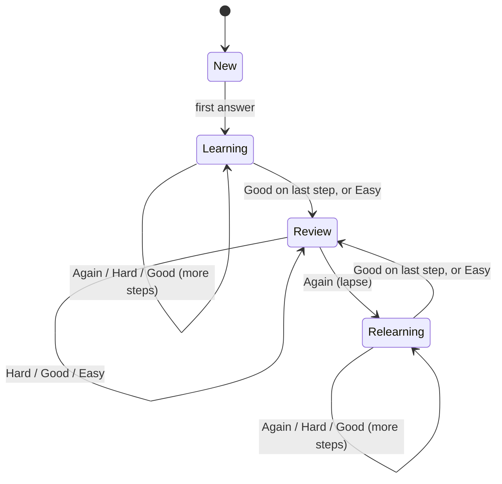

# Scheduling

Kardo uses an SM-2 style scheduler, the same family of algorithm Anki used for most of its history. It's
predictable, easy to reason about, and works well with the four answer buttons. The code is the `schedule()`
function in [`server.py`](../server.py), and its behaviour is pinned down by tests in
[`tests/test_kardo.py`](../tests/test_kardo.py).

## Card states

### New and learning cards

A new card walks through the **learning steps**, measured in minutes (default `1 10`):

| Button | Effect |
|---|---|
| Again | Back to the first step |
| Hard | Repeat the current step (on the first step: halfway between steps 1 and 2) |
| Good | Next step; after the last step the card **graduates** with the *graduating interval* (1 day) |
| Easy | Graduates immediately with the *easy interval* (4 days) |

### Review cards

Each review card has an **interval** (days until it's due) and an **ease** (starting at 2.5, i.e. 250%).

| Button | New interval | Ease |
|---|---|---|
| Again | Card lapses: goes to relearning, interval × *lapse multiplier* (min. 1 day) | −0.20 |
| Hard | interval × *hard multiplier* (1.2), at least +1 day | −0.15 |
| Good | (interval + half the days overdue) × ease | unchanged |
| Easy | (interval + days overdue) × ease × *easy bonus* (1.3) | +0.15 |

Ease never drops below 1.3, and each button always gives a longer interval than the one to its left.
Intervals of 3 days or more get **±5% fuzz** so cards learned together spread out over time. The interval under
each button is shown before you tap it.

### The study day

"Today" runs from the **New day starts at** hour (default 4 am) in your phone's time zone, so a late-night
session counts toward the day you think it does. The phone sends its UTC offset with every request.

## What gets shown next

1. Learning and relearning cards that are due now.
2. Otherwise, a mix of new and review cards, picked in proportion to how many of each are left today.
3. If nothing is left, learning cards due in the next 20 minutes are shown early rather than making you wait.

Daily limits apply per deck you study: **New cards per day** (25) and **Maximum reviews per day** (400).

### Order of new cards

| Setting | Behaviour |
|---|---|
| Mix subdecks (default) | One card from each subdeck in turn. Good for exam prep: every section shows up from day one |
| In order | The deck's own order, subdeck by subdeck |
| Random | Shuffled, but stable between sessions |

## Settings reference

Settings live in the app under ⚙️ and apply to the whole collection.

| Setting | Default | Meaning |
|---|---|---|
| New cards per day | 25 | New cards introduced per day |
| Maximum reviews per day | 400 | Cap on review cards answered per day |
| Order of new cards | Mix subdecks | See above |
| New day starts at (hour) | 4 | Local hour when the next study day begins |
| Learning steps (minutes) | `1 10` | Gaps before a new card graduates |
| Relearning steps (minutes) | `10` | Gaps after a lapse before the card returns to review |
| Graduating interval (days) | 1 | First interval after the last learning step |
| Easy interval (days) | 4 | First interval when a new card is answered Easy |
| Maximum interval (days) | 36500 | Longest interval a card can get |

Advanced settings, available through the [API](api.md) (`POST /api/settings`):

| Key | Default | Meaning |
|---|---|---|
| `starting_ease` | 2.5 | Ease given to a card when it's first answered |
| `easy_bonus` | 1.3 | Extra multiplier for Easy on review cards |
| `hard_mult` | 1.2 | Interval multiplier for Hard |
| `lapse_mult` | 0.0 | Fraction of the interval kept after a lapse |

## Recipes

**Exam in four weeks.** Set *Maximum interval* to 7. Pick *New cards per day* so every card is introduced at least
a week before the exam: cards ÷ (days left − 7). Use *Mix subdecks* so all sections get attention. In the last week,
use **Cards I've forgotten before** on the deck screen to drill weak spots without disturbing the schedule.

**Language vocabulary for the long haul.** Leave the defaults, keep new cards at 10 to 20 a day, and never skip reviews.

**Too many reviews piling up.** Lower *New cards per day* for a while; the review load follows about two weeks later.

## Practice mode

The quiz buttons on a deck's screen (20 or 50 random cards, or only cards you've forgotten before) show cards and
keep score, but **don't change any schedule**. Use them to cram or warm up as often as you like.
